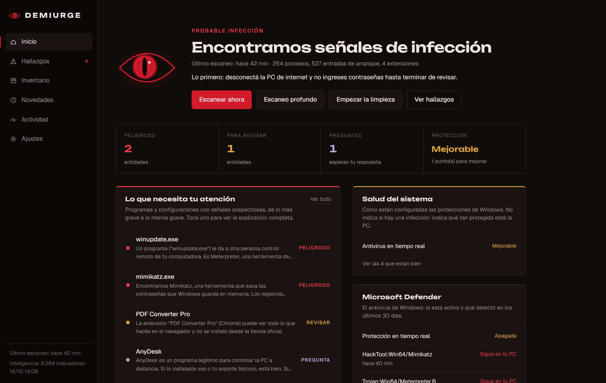
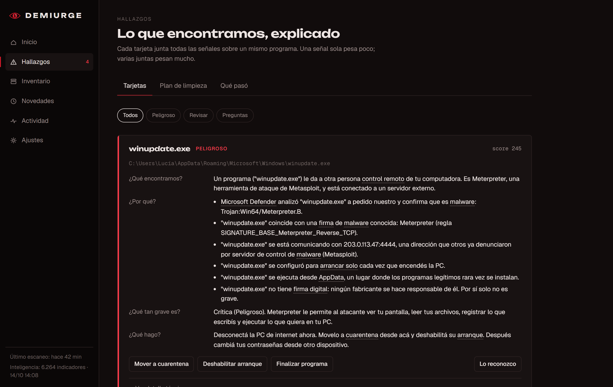
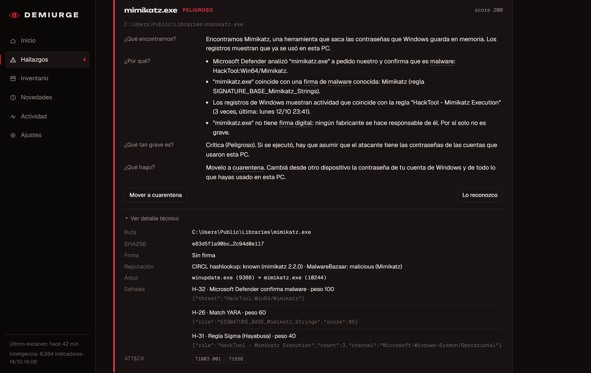
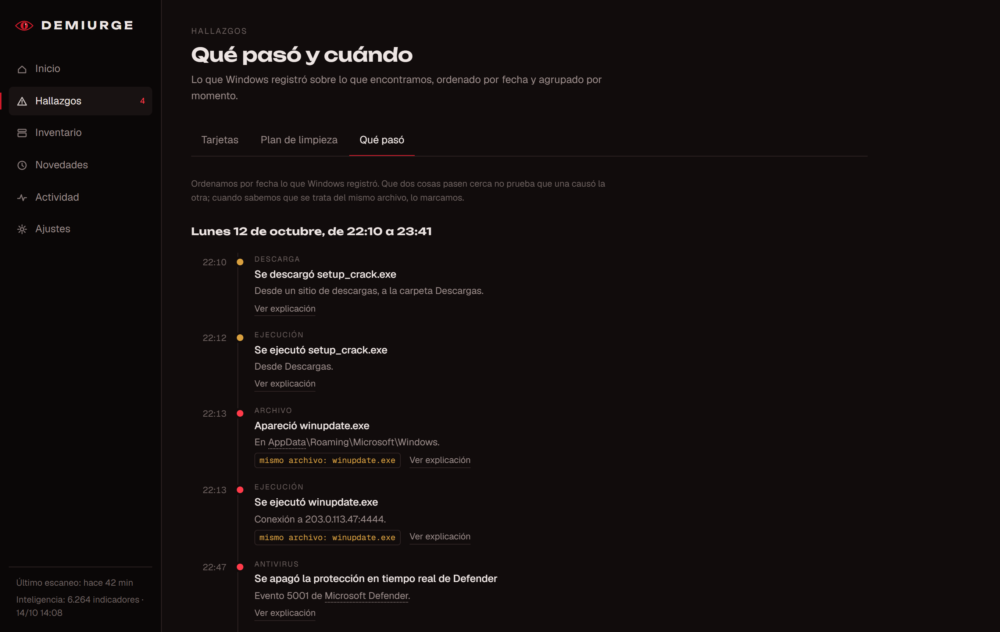
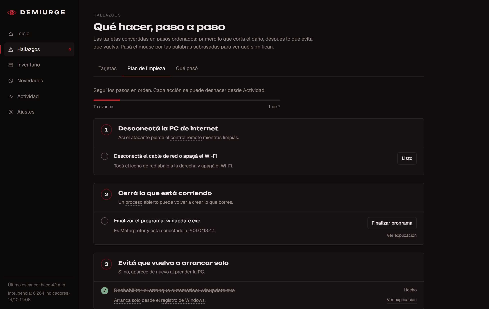

# Demiurge

> [!WARNING]
> **Portfolio project, discontinued.** Demiurge runs with administrator rights, the installer is unsigned, and its detection was never measured against real malware. Read the code rather than installing it on a machine you care about. It went through a security audit and every issue found was fixed ([`SECURITY-AUDIT.md`](SECURITY-AUDIT.md)).

## What it is

A Windows 10/11 desktop app that answers one question: **is my PC clean or infected?** It collects the traces Windows leaves behind, analyzes them with several detection engines and explains every finding in plain language (the UI is in Spanish).

It is a **visibility and second-opinion tool, not an antivirus**: no real-time protection, nothing runs in the background, and it does not replace Microsoft Defender.

## Who it is for

**Home users with no technical background.** Each finding answers four questions (what we found, why, how serious, what to do), technical words have a hover glossary, and a step-by-step cleanup plan guides the fix. Each card also has a technical view with raw data, the rules that fired and MITRE ATT&CK techniques.

## What it does

- **Inspects 28 areas of Windows** using native APIs: processes, network connections, DNS, everything that starts automatically (registry, services, tasks, WMI…), browsers and extensions, hosts/DNS/proxy, firewall rules, root certificates, accounts, drivers, Defender status and history, execution history (including deleted programs), typed commands, event logs and system health.
- **Detects** common home threats: info-stealers, remote-access scams, "ClickFix" pasted commands, browser hijacking, rogue root certificates, Defender exclusions, tampered apps (Discord), brute-force logons.
- **Scores per program, not per event**: 40 rules; one weak signal stays informational, several together escalate. When engines disagree, the alarm is lowered and the card says so.
- **Explains and guides**: verdict, finding cards, a cleanup plan, a "what happened" timeline (real timestamps, only links events that involve the same file), a full inventory and a diff against the previous scan.
- **Acts only with confirmation, and reversibly**: disable startup entries, quarantine (never delete), remove extensions, restore browser/proxy/hosts, remove Defender exclusions or certificates, repair Discord. Everything can be undone except killing a process.

## Screenshots

These use the UI's built-in sample data (`src/Demiurge.App/web/src/mock.ts`), not a real scan: a fake "crack" that drops a Metasploit Meterpreter payload, which later runs Mimikatz. The UI is in Spanish.

| | |
|---|---|
|  |  |
| **Verdict.** What was found and what to do first. | **Finding card.** What, why, how serious, what to do. |
|  |  |
| **Technical view.** Rules that fired, raw data, ATT&CK. | **Timeline.** Real timestamps, linked when it's the same file. |


**Cleanup plan.** The findings turned into ordered, reversible steps.

## Status

**Discontinued (October 2026), beta.** Calibrated for false positives on a real PC without admin rights. Not verified: full behavior installed and elevated, actions on a real system, and detection against real malware in VMs. The installer is unsigned (SmartScreen will warn).

The last build is [`v0.2.0-beta`](https://github.com/0xherni/demiurge/releases/tag/v0.2.0-beta):

| File | SHA-256 |
|---|---|
| `DemiurgeSetup.msi` | `e72cb0cfd0c954906af51b25877436f6c2d1c4dc77e64ba0ff6bb1d47ce23047` |

Check it with `Get-FileHash .\DemiurgeSetup.msi` in PowerShell.

## Connected tools

| Tool | Used for |
|---|---|
| Microsoft Defender | Second opinion on suspicious files (`-DisableRemediation`: never deletes on its own) and detection history |
| YARA-X + YARA Forge rules (bundled) | Known malware family traits inside files |
| HollowsHunter / PE-sieve (bundled) | Code injected into legitimate processes |
| Hayabusa + Sigma rules (bundled) | Thousands of community rules over Windows event logs |
| abuse.ch (ThreatFox, URLhaus, Feodo), LOLBAS, LOLDrivers, Microsoft authroot | Threat intel lists, downloaded and matched locally |
| CIRCL hashlookup, MalwareBazaar, VirusTotal (optional) | Hash reputation — files are never uploaded |

Bundled tools are pinned by version and SHA-256 (`src/Demiurge.Core/Resources/tools.lock.json`) and verified before every run.

## Tech

.NET 10, WPF + WebView2, React 19 + TypeScript + Vite, SQLite, WMI, P/Invoke (WinVerifyTrust, iphlpapi, ntdll…), WiX 6 installer. The engine runs in-process; closing the window ends everything (no service, no scheduled task).

```
src/Demiurge.Core   Engine: collectors, intel, rules, scoring, storage, actions
src/Demiurge.App    Desktop app (WPF + WebView2) and its React UI (web/)
src/Demiurge.Cli    Console for development and diagnostics
tests/              102 tests, including the attacks from the security audit
installer/          WiX MSI
```

```powershell
dotnet build Demiurge.sln
dotnet test Demiurge.sln
.\build-installer.ps1        # tests + self-contained publish + artifacts\DemiurgeSetup.msi
```
